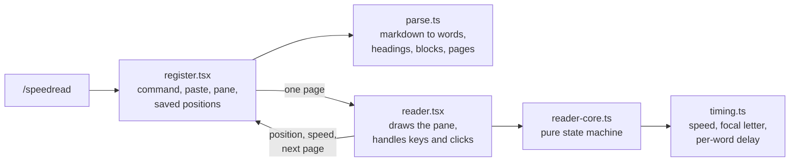

# speedread

A speed reader inside Claude Code. Run `/speedread` to play Claude's last reply, a markdown file, or pasted text one word at a time in a side pane.

It uses RSVP (rapid serial visual presentation). Each word appears at the same spot on screen with one letter highlighted, so your eyes stay in one place. Tables, code, diagrams, and lists pause the reader and show in full until you press Enter.

## Install

Run this at the Claude Code prompt in a terminal:

```
/plugin install speedread --marketplace jimmysteinmetz/speedread-cc
```

Press `y` to add the marketplace, then pick a scope. User scope turns it on in every session. Claude Code confirms with `Installed speedread. Plugin is now active.`

The install command only runs in the terminal. If you install at user scope, speedread also works in the Code tab of the Claude desktop app.

## Use

| Command | Reads |
| --- | --- |
| `/speedread` | Claude's last reply |
| `/speedread notes.md` | A `.md`, `.markdown`, or `.txt` file. `~/` paths work. |
| `/speedread paste` | The next prompt you send. It opens in the reader and is not sent to Claude. Run `/speedread paste` again to cancel. |

Click the pane to start.

| Key | Does |
| --- | --- |
| `Space` | Pause or play. While paused, the surrounding paragraph shows so you can re-read without losing your place. |
| `←` | Back. Restarts the current sentence if you are more than 1.5 s into it, otherwise goes to the previous one. |
| `↑` `↓` | Speed up or slow down by 25 wpm (100 to 1000). On a table or code block, scrolls it instead. |
| `Enter` | Continue past a table, code block, or list. Accept the resume prompt. Close when finished. |
| `r` | Start over instead of resuming. |
| `q` / `Esc` | Close the reader. |

The bar along the bottom shows percent read, estimated time left, and current speed.

## What it does with your text

- **Pacing.** Each word shows for `60000 / wpm` ms. Long words, numbers, and acronyms stay up longer. Words that end a clause, sentence, or paragraph pause longer still.
- **Headings** show on their own for 1.5 s.
- **Blocks** (tables, code, Mermaid diagrams, lists, block quotes, `$$` math, images) render as markdown and wait for `Enter`.
- **Skipped:** YAML front matter, horizontal rules, and lines of raw HTML.
- **After a pause or a block,** a dot blinks at the focal point for a second so your eye is in the right place when words resume.

## What it remembers

- Your reading speed, across sessions.
- Your place in each file, so reopening it offers to resume. Editing a file resets its saved place. speedread remembers up to 50 files and forgets a file once you finish it.

Replies and pasted text are not saved.

## Privacy

speedread makes no network calls and never calls a model. It reads only the file you name or the last reply in your session, and it saves only your speed and file positions, in Claude Code's local plugin storage. Run `claude plugin validate .` on the repo to see every Claude Code API it calls.

## Requirements

- Claude Code. Tested on 2.1.295; older versions may lack the plugin features speedread uses.
- The terminal or the Claude desktop app. Other surfaces show a message instead of the reader.

## Limitations

- Reads `.md`, `.markdown`, and `.txt` only. No PDFs.
- Lists show whole rather than playing word by word, since Claude's replies tend to be list-heavy. Set `LISTS_AS_BLOCKS` to `false` in `hooks/parse.ts` to play them as prose.
- One document at a time. Running `/speedread` again replaces what is open.

## Update and uninstall

```
claude plugin marketplace update speedread-cc
claude plugin update speedread@speedread-cc
```

Restart Claude Code after updating.

```
claude plugin uninstall speedread@speedread-cc
```

## How it works

speedread is a Claude Code plugin made of a single hooks module. There is no build step: Claude Code loads the TypeScript directly.



| File | Role |
| --- | --- |
| `hooks/register.tsx` | Registers `/speedread`, intercepts the prompt in paste mode, opens the pane, and saves speed and position. |
| `hooks/parse.ts` | Turns markdown into words, headings, and blocks, and splits long documents into pages under Claude Code's 100,000-character limit on pane data. |
| `hooks/reader.tsx` | The pane. Runs a 20 ms tick, takes keys and clicks, and draws the current state. |
| `hooks/reader-core.ts` | Every reader transition (play, pause, back, page turns, resume) as pure functions. Most tests live here. |
| `hooks/timing.ts` | Speed limits, per-word delay, and the focal letter's position. |

## Development

```sh
git clone https://github.com/jimmysteinmetz/speedread-cc
cd speedread-cc
claude --plugin-dir .         # run Claude Code with your working copy loaded
claude plugin validate .      # check the manifests and the hooks module
claude plugin test .          # run the tests
```

The first `--plugin-dir` session writes Claude Code's type definitions to `.claude-plugin/types/` (git-ignored). After that, `npx -p typescript tsc -p .` type-checks the project.

Issues and pull requests are welcome. Please run `validate` and `test` before opening a PR.

## Credits

The focal letter positions follow [OpenSpritz](https://github.com/Miserlou/OpenSpritz).

## License

[MIT](LICENSE)
